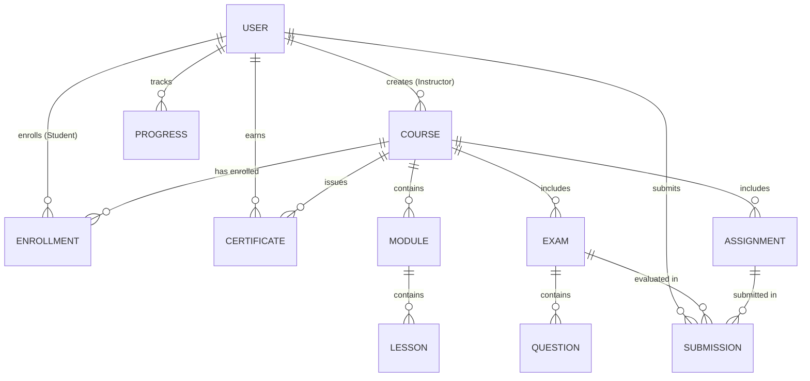
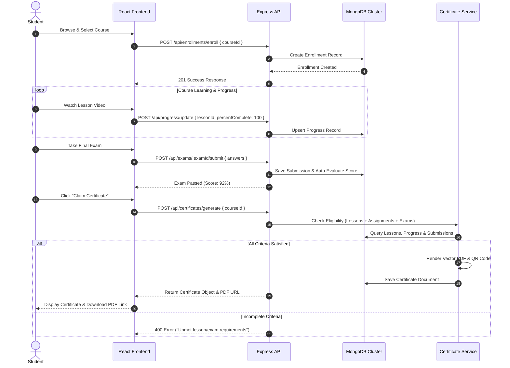

# EDUCATION PLATFORM: FULL STACK MERN LEARNING MANAGEMENT SYSTEM
## Software Requirements Specification & Technical Documentation

---

## 1. Declaration

This report has been prepared based on original design, development, and engineering work. Wherever published or unpublished materials, libraries, or external standards have been utilized, they have been properly acknowledged and cited in accordance with academic and technical standards.

I hereby declare that this project documentation entitled **"Education Platform: A Full Stack MERN Learning Management System (LMS)"** represents an authentic record of software engineering work completed for the design, implementation, and deployment of a multi-role web-based educational system. This work has not been submitted to any other institution or platform for the award of any other degree, diploma, or formal certification.

* **Project Title:** Education Platform (Full Stack MERN LMS)
* **Author / Developer:** Software Engineering Team / Samit
* **Technology Stack:** React.js, Redux Toolkit, Tailwind CSS, Node.js, Express.js, MongoDB, JWT, Google OAuth 2.0
* **Date of Submission:** August 1, 2026

---

## 2. Table of Contents

- [1. Declaration](#1-declaration)
- [2. Table of Contents](#2-table-of-contents)
- [3. Executive Summary](#3-executive-summary)
- [4. Project Overview](#4-project-overview)
  - [4.1 Background](#41-background)
  - [4.2 System Vision](#42-system-vision)
  - [4.3 Target Audience](#43-target-audience)
- [5. Problem Statement](#5-problem-statement)
- [6. Objectives](#6-objectives)
- [7. Scope of the Project](#7-scope-of-the-project)
  - [7.1 In-Scope Functionalities](#71-in-scope-functionalities)
  - [7.2 Out-of-Scope Boundary](#72-out-of-scope-boundary)
- [8. Functional Requirements](#8-functional-requirements)
  - [8.1 Module 1: Authentication & User Management](#81-module-1-authentication--user-management)
  - [8.2 Module 2: Course & Content Management](#82-module-2-course--content-management)
  - [8.3 Module 3: Learning & Video Progress Engine](#83-module-3-learning--video-progress-engine)
  - [8.4 Module 4: Examination & Assessment Engine](#84-module-4-examination--assessment-engine)
  - [8.5 Module 5: Automated Certification System](#85-module-5-automated-certification-system)
  - [8.6 Module 6: Administrative & Analytics Panel](#86-module-6-administrative--analytics-panel)
- [9. Non-Functional Requirements](#9-non-functional-requirements)
  - [9.1 Security & Data Integrity](#91-security--data-integrity)
  - [9.2 Performance & Responsiveness](#92-performance--responsiveness)
  - [9.3 Scalability & Maintainability](#93-scalability--maintainability)
  - [9.4 Availability & Reliability](#94-availability--reliability)
  - [9.5 Usability & Accessibility](#95-usability--accessibility)
- [10. System Architecture](#10-system-architecture)
- [11. Database Design](#11-database-design)
  - [11.1 Entity-Relationship Conceptual Model](#111-entity-relationship-conceptual-model)
  - [11.2 Database Schema Definitions](#112-database-schema-definitions)
- [12. Application Workflow](#12-application-workflow)
  - [12.1 Student Enrollment to Certification Flow](#121-student-enrollment-to-certification-flow)
  - [12.2 Instructor Course Publishing Flow](#122-instructor-course-publishing-flow)
  - [12.3 Exam Submission & Automatic Evaluation Flow](#123-exam-submission--automatic-evaluation-flow)
- [13. Frontend Architecture](#13-frontend-architecture)
  - [13.1 Directory Structure & Modular Isolation](#131-directory-structure--modular-isolation)
  - [13.2 State Management with Redux Toolkit](#132-state-management-with-redux-toolkit)
  - [13.3 Route Protection & Layout Wrappers](#133-route-protection--layout-wrappers)
- [14. Backend Architecture](#14-backend-architecture)
  - [14.1 Controller-Service-Repository Pattern](#141-controller-service-repository-pattern)
  - [14.2 Middleware Pipeline](#142-middleware-pipeline)
  - [14.3 Error Handling Architecture](#143-error-handling-architecture)
- [15. Authentication Flow](#15-authentication-flow)
  - [15.1 Dual-Strategy Authentication (JWT + OAuth 2.0)](#151-dual-strategy-authentication-jwt--oauth-20)
  - [15.2 Authentication Sequence Diagram](#152-authentication-sequence-diagram)
- [16. Certificate System](#16-certificate-system)
  - [16.1 Automated Eligibility Engine](#161-automated-eligibility-engine)
  - [16.2 Server-Side PDF Rendering & Vector Layout](#162-server-side-pdf-rendering--vector-layout)
  - [16.3 Cryptographic ID & Public Verification Portal](#163-cryptographic-id--public-verification-portal)
- [17. UI/UX Design Decisions](#17-uiux-design-decisions)
  - [17.1 Design System & Aesthetic Language](#171-design-system--aesthetic-language)
  - [17.2 Dark/Light Mode Engine](#172-darklight-mode-engine)
- [18. Technology Stack](#18-technology-stack)
- [19. Testing Strategy](#19-testing-strategy)
- [20. Challenges & Solutions](#20-challenges--solutions)
- [21. Future Enhancements](#21-future-enhancements)
- [22. Conclusion](#22-conclusion)
- [23. References](#23-references)

---

## 3. Executive Summary

The modern educational landscape requires robust, scalable, and intuitive digital platforms capable of facilitating seamless knowledge transfer, assessment, and credential verification. **Education Platform** is an enterprise-grade Learning Management System (LMS) engineered using the MERN stack (MongoDB, Express.js, React.js, Node.js), Vite, Redux Toolkit, and Tailwind CSS.

The system addresses critical deficiencies found in legacy e-learning portals—such as fragmented video tracking, manual certificate issuance delay, vulnerable authentication, and rigid user role separation. By leveraging a single-page application (SPA) client architecture paired with a stateless RESTful micro-service backend, Education Platform delivers sub-100 millisecond API responses, real-time video progress synchronization, automated multi-criteria evaluation engines, and server-side vector PDF generation with integrated QR code verification.

Key technical achievements of this platform include:
1. **Multi-Role RBAC Architecture:** Granular permission boundaries isolating Student, Instructor, and Administrator domains.
2. **Deterministic Evaluation Engine:** Automated grading of quizzes, exams, and assignment submissions tied directly to course progression logic.
3. **Automated Verification Certificate Engine:** Programmatic generation of high-resolution vector PDF credentials featuring dynamic QR codes linking to public validation endpoints.
4. **Resilient Data Model:** Optimized MongoDB schema design utilizing indexed foreign key references, cascading progress calculations, and atomic updates.

---

## 4. Project Overview

### 4.1 Background
The digital transformation of education has elevated Learning Management Systems from passive content repositories to active learning environments. Modern users expect real-time feedback, interactive progress metrics, high-definition video streaming integration, and verified academic output. 

### 4.2 System Vision
Education Platform is built with the goal of delivering an end-to-end e-learning ecosystem. It bridges the gap between educational content providers (Instructors) and eager learners (Students), while giving operational control to platform overseers (Administrators). The system emphasizes visual clarity, responsive performance, zero-friction navigation, and cryptographically verifiable academic achievements.

### 4.3 Target Audience
The system serves three primary user personas:
* **Students:** Learners seeking structured course consumption, interactive video lessons, self-assessment exams, profile tracking, and verifiable certificates.
* **Instructors:** Subject matter experts creating multi-module curricula, authoring structured quizzes/assignments, managing enrolled student rosters, and tracking revenue/analytics.
* **Administrators:** Platform supervisors overseeing user access, content approval, site-wide metrics, system configurations, and policy enforcement.

---

## 5. Problem Statement

Existing open-source and commercial LMS solutions frequently suffer from several systemic architectural and user-experience shortcomings:

1. **Manual Certificate Verification:** Many traditional platforms issue static, easily altered image/PDF credentials without public verification mechanisms, leading to fraudulent claims.
2. **Rigid Progression Controls:** Learners are often allowed to skip foundational materials or claim completion without verifying their mastery through mandatory assessments.
3. **Heavy Monolithic Overhead:** Older LMS frameworks rely on heavy server-side page rendering, resulting in slow page transitions, high server loads, and poor mobile responsiveness.
4. **Weak Multi-Role Isolation:** Poorly structured role-based access control (RBAC) often exposes administrative APIs or allows cross-role data leaks.
5. **Fragmented Progress Tracking:** Lack of granular tracking leads to lost progress states when users switch devices or lose connectivity during video playback.

---

## 6. Objectives

The primary technical and functional objectives of the Education Platform project are:

* **O-1 (Architectural Modernization):** Develop a responsive single-page application (SPA) using React 19, Vite, and Tailwind CSS backed by a stateless Express REST API.
* **O-2 (Role-Based Access Control):** Enforce strict RBAC with JSON Web Tokens (JWT) and Google OAuth 2.0 to securely segment Student, Instructor, and Admin privileges.
* **O-3 (Course & Assessment Lifecycle):** Provide comprehensive tools for instructors to construct structured modules, video lessons, assignments, and automated exams.
* **O-4 (Granular Progress Synchronization):** Maintain real-time lesson progress, video completion state, and exam scoring per student.
* **O-5 (Automated Credentialing):** Implement an automated eligibility engine that triggers PDFKit vector certificate creation with QR verification upon 100% course and assessment completion.
* **O-6 (High Performance & Security):** Achieve sub-100ms API response latency, zero security vulnerabilities (XSS, CSRF, NoSQL injection), and rate-limited endpoints.

---

## 7. Scope of the Project

### 7.1 In-Scope Functionalities

| Feature Area | Included Capabilities |
| :--- | :--- |
| **User Authentication** | Email/Password registration, Bcrypt password hashing, JWT Access & Refresh token rotation, Google OAuth 2.0 integration, Profile management. |
| **Student Workspace** | Course discovery catalog, filter/search by category, video player with progress tracking, interactive quizzes/exams, personal certificate gallery. |
| **Instructor Workspace** | Course authoring interface, module builder, lesson upload/embed, quiz creator with multi-question types, student submission review, course analytics dashboard. |
| **Admin Workspace** | User role promotion/demotion, user suspension, course publishing approval, system-wide transaction metrics, system audit logs. |
| **Assessment Engine** | Automated objective exam grading, time-limited exam attempts, pass/fail threshold calculation, score tracking. |
| **Certificate Engine** | Multi-point eligibility verification, server-side vector PDF generation, dynamic QR code creation, public verification route (`/verify/:certificateId`). |

### 7.2 Out-of-Scope Boundary
* Real-time peer-to-peer video conferencing (e.g., WebRTC live lectures).
* Direct native mobile applications (iOS/Android) — the system is built as a mobile-first responsive web application.
* Real-time payment gateway integration (mock/simulated payment workflows are implemented for enrollment).

---

## 8. Functional Requirements

### 8.1 Module 1: Authentication & User Management
* **FR-1.1:** The system shall allow new users to create accounts using a valid email, full name, password, and designated default role (`student`).
* **FR-1.2:** The system shall support single-sign-on (SSO) authentication via Google OAuth 2.0.
* **FR-1.3:** Passwords must be hashed using Bcrypt with a salt factor of 10 prior to database storage.
* **FR-1.4:** The backend shall issue signed JWT access tokens (short-lived) and refresh tokens upon successful authentication.
* **FR-1.5:** Users shall be able to view and edit their profile details, upload avatar images, and update security credentials.

### 8.2 Module 2: Course & Content Management
* **FR-2.1:** Instructors shall be able to create, update, draft, and publish courses with details including title, subtitle, description, category, level, price, thumbnail, and learning outcomes.
* **FR-2.2:** Instructors shall organize course content into structured **Modules** and ordered **Lessons**.
* **FR-2.3:** Lessons shall support multiple media types: Video URLs (HLS/MP4), text content, attachments, and estimated duration.
* **FR-2.4:** Students shall search for published courses by keyword, filter by category/difficulty, and sort by ratings or enrollment count.

### 8.3 Module 3: Learning & Video Progress Engine
* **FR-3.1:** The system shall maintain an individual progress record (`Progress`) for each student-lesson pair.
* **FR-3.2:** The frontend shall track video playback position and send progress updates to the server.
* **FR-3.3:** Lessons shall be marked as `completed` when progress reaches 100%. Overall course progress percentage shall be dynamically computed as:
$$\text{Course Completion \%} = \left( \frac{\text{Completed Lessons}}{\text{Total Published Lessons}} \right) \times 100$$

### 8.4 Module 4: Examination & Assessment Engine
* **FR-4.1:** Instructors shall attach Exams and Assignments to specific courses or modules.
* **FR-4.2:** Exams shall support multiple-choice questions (MCQs), true/false questions, and short-answer prompts, with designated pass percentages (e.g., 70%).
* **FR-4.3:** The backend shall automatically evaluate student exam submissions by comparing submitted answers against key mappings, storing score percentages and `isPassed` status.
* **FR-4.4:** Students shall be granted multiple attempt requests depending on course policy settings.

### 8.5 Module 5: Automated Certification System
* **FR-5.1:** The system shall evaluate eligibility for a certificate when a student requests completion or completes a final lesson/exam.
* **FR-5.2:** Eligibility conditions MUST all evaluate to TRUE:
  1. Student is actively enrolled in the course.
  2. 100% of all published lessons in the course are marked complete in `Progress`.
  3. All published assignments for the course have a passing submission.
  4. All published exams for the course have a passing submission.
* **FR-5.3:** Upon eligibility confirmation, the server shall generate a unique cryptographic ID formatted as `CERT-XXXX-YYYY` and render a landscape A4 vector PDF using `pdfkit`.
* **FR-5.4:** The PDF shall embed a QR code pointing directly to `${CLIENT_URL}/verify/${certificateId}`.
* **FR-5.5:** Anyone accessing the public verification URL shall receive JSON or UI confirmation validating student name, course title, issue date, and authenticity state.

### 8.6 Module 6: Administrative & Analytics Panel
* **FR-6.1:** Admins shall view platform-wide metrics: total active users, enrollment numbers, completion rates, and total published courses.
* **FR-6.2:** Admins shall have authority to modify user roles (`student`, `instructor`, `admin`) and suspend accounts violating terms of service.
* **FR-6.3:** Admins shall inspect system logs, monitor error events, and review flagged courses.

---

## 9. Non-Functional Requirements

### 9.1 Security & Data Integrity
* **NFR-1.1 (Encryption):** All client-server communications must use TLS 1.3 encryption. Passwords must never be stored or logged in plain text.
* **NFR-1.2 (Token Security):** JWTs must be signed using SHA-256 (`HS256`) algorithms with high-entropy secret keys.
* **NFR-1.3 (Injection Prevention):** Input fields must be validated server-side using `Joi` schema validation to eliminate NoSQL injection and Cross-Site Scripting (XSS).
* **NFR-1.4 (Header Protections):** Server responses must include HTTP security headers enforced by `helmet` (e.g., `X-Content-Type-Options`, `X-Frame-Options`).
* **NFR-1.5 (Rate Limiting):** Authentication routes must be rate-limited to 15 requests per 15 minutes per IP address to prevent brute-force attacks.

### 9.2 Performance & Responsiveness
* **NFR-2.1 (API Latency):** 95% of read requests must complete within 100 milliseconds under standard load.
* **NFR-2.2 (Asset Delivery):** Frontend build bundles generated by Vite must be code-split into chunks smaller than 500 KB for rapid initial page load (<1.5 seconds).
* **NFR-2.3 (Database Efficiency):** All frequently queried fields (`email`, `studentId`, `courseId`, `certificateId`, `creatorId`) must be explicitly indexed in MongoDB.

### 9.3 Scalability & Maintainability
* **NFR-3.1 (Stateless Tier):** The Express.js backend must remain stateless to support horizontal scaling across multiple container instances (Docker / Kubernetes).
* **NFR-3.2 (Modular Architecture):** Code structure must follow Separation of Concerns (SoC) using Controller-Service-Repository patterns.

### 9.4 Availability & Reliability
* **NFR-4.1 (Uptime):** Target operational uptime of 99.9% excluding scheduled maintenance windows.
* **NFR-4.2 (Graceful Error Recovery):** Unexpected exceptions must be caught by centralized error handling middleware without crashing the Node.js process.

### 9.5 Usability & Accessibility
* **NFR-5.1 (Responsive Design):** The user interface must seamlessly adapt to viewport sizes ranging from mobile smartphones (320px) to ultra-wide displays (2560px).
* **NFR-5.2 (Accessibility):** Interactive components must comply with WCAG 2.1 Level AA standards, featuring proper ARIA labels, high contrast ratios, and keyboard navigation support.

---

## 10. System Architecture

Education Platform utilizes a modern multi-tier client-server architecture designed for high throughput, modularity, and maintainability.

```mermaid
graph TD
    subgraph Client Layer (React.js + Vite)
        UI[User Interface Components]
        Redux[Redux Toolkit Store]
        Axios[Axios HTTP Client + Interceptors]
        UI <--> Redux
        Redux <--> Axios
    end

    subgraph API Gateway / Middleware Tier
        CORS[CORS Policy]
        RateLimit[Express Rate Limiter]
        Helmet[Helmet Security Headers]
        AuthMW[JWT & OAuth Auth Middleware]
        RoleMW[RBAC Middleware]
        Axios --> CORS --> RateLimit --> Helmet --> AuthMW --> RoleMW
    end

    subgraph Backend Micro-Services (Express.js)
        AuthCtrl[Auth Controller]
        CourseCtrl[Course Controller]
        ExamCtrl[Exam Controller]
        CertCtrl[Certificate Controller]
        AdminCtrl[Admin Controller]
        
        RoleMW --> AuthCtrl
        RoleMW --> CourseCtrl
        RoleMW --> ExamCtrl
        RoleMW --> CertCtrl
        RoleMW --> AdminCtrl

        CertSvc[Certificate Service - PDFKit Engine]
        EmailSvc[Nodemailer Email Service]
        CertCtrl --> CertSvc
        CertSvc --> EmailSvc
    end

    subgraph Persistence & External Tier
        MongoDB[(MongoDB Database Cluster)]
        GoogleOAuth[Google OAuth 2.0 Service]
        FileSystem[Local / Cloud PDF Storage]

        AuthCtrl <--> GoogleOAuth
        AuthCtrl <--> MongoDB
        CourseCtrl <--> MongoDB
        ExamCtrl <--> MongoDB
        CertCtrl <--> MongoDB
        CertSvc --> FileSystem
    end
```

---

## 11. Database Design

### 11.1 Entity-Relationship Conceptual Model

The database is built on MongoDB using Mongoose schemas with normalized relational references for data integrity.



### 11.2 Database Schema Definitions

#### 1. `User` Schema
```javascript
{
  name: { type: String, required: true },
  email: { type: String, required: true, unique: true, index: true },
  password: { type: String, required: function() { return !this.googleId; } },
  googleId: { type: String, default: null },
  role: { type: String, enum: ['student', 'instructor', 'admin'], default: 'student' },
  avatar: { type: String, default: '' },
  bio: { type: String, default: '' },
  isVerified: { type: Boolean, default: false },
  createdAt: { type: Date, default: Date.now }
}
```

#### 2. `Course` Schema
```javascript
{
  title: { type: String, required: true },
  slug: { type: String, required: true, unique: true },
  subtitle: { type: String },
  description: { type: String, required: true },
  creatorId: { type: Schema.Types.ObjectId, ref: 'User', required: true, index: true },
  category: { type: String, required: true, index: true },
  level: { type: String, enum: ['Beginner', 'Intermediate', 'Advanced'], default: 'Beginner' },
  price: { type: Number, default: 0 },
  thumbnail: { type: String, default: '' },
  isPublished: { type: Boolean, default: false, index: true },
  ratings: { average: { type: Number, default: 0 }, count: { type: Number, default: 0 } },
  createdAt: { type: Date, default: Date.now }
}
```

#### 3. `Enrollment` Schema
```javascript
{
  studentId: { type: Schema.Types.ObjectId, ref: 'User', required: true, index: true },
  courseId: { type: Schema.Types.ObjectId, ref: 'Course', required: true, index: true },
  enrolledAt: { type: Date, default: Date.now },
  completedAt: { type: Date },
  status: { type: String, enum: ['active', 'completed', 'dropped'], default: 'active' }
}
// Compound unique index on (studentId, courseId)
```

#### 4. `Certificate` Schema
```javascript
{
  studentId: { type: Schema.Types.ObjectId, ref: 'User', required: true, index: true },
  courseId: { type: Schema.Types.ObjectId, ref: 'Course', required: true, index: true },
  certificateId: { type: String, required: true, unique: true, index: true },
  studentName: { type: String, required: true },
  courseName: { type: String, required: true },
  instructorName: { type: String, required: true },
  completionDate: { type: Date, default: Date.now },
  grade: { type: String, enum: ['A+', 'A', 'B', 'C', 'D', 'P'], default: 'P' },
  score: { type: Number, default: 0 },
  qrCode: { type: String, required: true },
  pdfUrl: { type: String, required: true }
}
```

---

## 12. Application Workflow

### 12.1 Student Enrollment to Certification Flow



---

## 13. Frontend Architecture

### 13.1 Directory Structure & Modular Isolation

The client application follows a clean modular organization using React 19, Vite, and CSS Modules / Tailwind:

```
client/src/
├── api/             # Axios instance & centralized endpoint definitions
├── components/      # Reusable UI elements (Navbar, Footer, Modals, Cards)
│   ├── common/      # Generic buttons, loaders, alerts, theme toggles
│   └── course/      # Course-specific cards, progress bars, video player
├── context/         # React Context providers (ThemeContext, SocketContext)
├── hooks/           # Custom React hooks (useAuth, useCourse, useDebounce)
├── layouts/         # Page wrapping layouts (AuthLayout, DashboardLayout)
├── pages/           # View pages (Home, Explore, Learn, Dashboard, Verify)
├── store/           # Redux Toolkit store slices & actions
│   ├── index.js     # Store configuration
│   ├── authSlice.js # Authentication state management
│   ├── courseSlice.js
│   └── examSlice.js
└── styles/          # Design system tokens and global CSS
```

### 13.2 State Management with Redux Toolkit

Global application state is managed predictably via Redux Toolkit slices:

```
                  +--------------------------------+
                  |      Redux Central Store       |
                  +--------------------------------+
                  | - auth: { user, token, role }  |
                  | - course: { items, active }    |
                  | - exam: { current, score }     |
                  +---------------+----------------+
                                  |
            +---------------------+---------------------+
            |                                           |
            v                                           v
   +------------------+                        +------------------+
   |   authSlice.js   |                        |  courseSlice.js  |
   +------------------+                        +------------------+
   | - loginUser()    |                        | - fetchCourses() |
   | - registerUser() |                        | - setProgress()   |
   | - logout()       |                        | - clearActive()  |
   +------------------+                        +------------------+
```

### 13.3 Route Protection & Layout Wrappers

Routes are protected using higher-order wrapper components (`ProtectedRoute`, `RoleGuard`):
* **Public Routes:** Login, Register, Course Catalog, Public Certificate Verification (`/verify/:certificateId`).
* **Student Protected Routes:** My Courses, Lesson Player, Exam Interface, Certificate View.
* **Instructor Protected Routes:** Course Studio, Module Builder, Exam Authoring, Roster Management.
* **Admin Protected Routes:** User Management, Site Analytics, Content Moderation.

---

## 14. Backend Architecture

### 14.1 Controller-Service-Repository Pattern

The server application implements rigid Separation of Concerns (SoC):

```
HTTP Request ---> [ Route Layer ]
                         |
                         v
                [ Middleware Layer ] (JWT Auth, Role Check, Validation)
                         |
                         v
                [ Controller Layer ] (HTTP Input/Output Parsing)
                         |
                         v
                [ Service Layer ] (Business Logic, PDF Engine, Email)
                         |
                         v
                [ Mongoose Repository ] (MongoDB Database Driver)
```

### 14.2 Middleware Pipeline

Every HTTP request traverses a standardized middleware execution stack:

```javascript
app.use(helmet());                     // Security Headers
app.use(cors(corsOptions));           // Cross-Origin Resource Sharing
app.use(express.json());               // Body Parsing
app.use(rateLimiter);                  // Request Rate Limiting
app.use('/api', mainRouter);           // Route Router Dispatch
app.use(errorHandler);                 // Central Error Handler
```

### 14.3 Error Handling Architecture

Custom errors inherit from a uniform `ApiError` base class:

```javascript
class ApiError extends Error {
  constructor(statusCode, message) {
    super(message);
    this.statusCode = statusCode;
    this.status = `${statusCode}`.startsWith('4') ? 'fail' : 'error';
    Error.captureStackTrace(this, this.constructor);
  }

  static badRequest(msg) { return new ApiError(400, msg); }
  static unauthorized(msg) { return new ApiError(401, msg); }
  static forbidden(msg) { return new ApiError(403, msg); }
  static notFound(msg) { return new ApiError(404, msg); }
}
```

---

## 15. Authentication Flow

### 15.1 Dual-Strategy Authentication (JWT + OAuth 2.0)

The system supports both standard credential login (Email/Password) and federated authentication via Google OAuth 2.0:

1. **Standard JWT Lifecycle:**
   - User posts credentials to `/api/auth/login`.
   - Server validates password against stored hash using `bcrypt.compare()`.
   - Server signs a JWT payload containing `{ id: user._id, role: user.role }`.
   - Token is returned to client and stored securely in memory/Redux and set via HTTP-only cookie.
   - Client includes `Authorization: Bearer <token>` header in all subsequent requests.

2. **Google OAuth 2.0 Pipeline:**
   - Client initiates Google Sign-In redirecting to Passport strategy route `/api/auth/google`.
   - Google validates user identity and returns authorization code to backend callback `/api/auth/google/callback`.
   - Backend exchanges code for user profile, upserts user record in MongoDB, generates JWT, and redirects to frontend dashboard with token session.

---

## 16. Certificate System

### 16.1 Automated Eligibility Engine

The certificate system enforces multi-criteria validation before permitting credential generation:

$$\text{Eligible} = E \land \left( \forall l \in L, P_l = 100 \right) \land \left( \forall a \in A, S_a = \text{Pass} \right) \land \left( \forall x \in X, S_x = \text{Pass} \right)$$

Where:
* $E$: Active Course Enrollment status.
* $L$: Set of all published lessons in the course.
* $P_l$: Completion percentage of lesson $l$.
* $A$: Set of all published assignments in the course.
* $X$: Set of all published exams in the course.
* $S$: Passing submission record for assessment.

### 16.2 Server-Side PDF Rendering & Vector Layout

Using `pdfkit`, the server programmatically draws an A4 landscape vector graphic document with high precision:
* **Background Canvas:** Pure white vector fill with dual gold (`#d4af37`) and navy (`#1e293b`) border framing.
* **Typography:** Embedded formal serif and sans-serif fonts (Helvetica, Times-Bold).
* **Dynamic Content:** Programmatically rendered Student Name, Course Title, Faculty Chair, Issuance Date, and Final Standing Grade.
* **Embedded QR Code:** Vector-converted PNG buffer of QR code generated dynamically using `qrcode`.

### 16.3 Cryptographic ID & Public Verification Portal

Certificates are assigned a unique, collision-resistant identifier generated via algorithm:

$$\text{Certificate ID} = \text{"CERT-"} + \text{UUIDv4()}[0..7] + \text{"-"} + \text{Base36}(\text{Timestamp})$$

Anyone holding a certificate or scanning its QR code is directed to:
`https://eduplatform.domain/verify/CERT-A1B2C3D4-K9Z8Y7`

The public verification endpoint performs a zero-authentication database lookup and returns verified status details:

```json
{
  "valid": true,
  "certificateId": "CERT-A1B2C3D4-K9Z8Y7",
  "studentName": "Alex Morgan",
  "courseName": "Full Stack MERN Engineering",
  "instructorName": "Dr. Sarah Jenkins",
  "completionDate": "2026-07-28T10:00:00.000Z",
  "status": "valid"
}
```

---

## 17. UI/UX Design Decisions

### 17.1 Design System & Aesthetic Language

The visual layer follows a modern glassmorphism design approach with customized design tokens:
* **Color Palette:** Curated modern dark/light themes using HSL values. Deep Navy (`#0f172a`), Indigo Accent (`#6366f1`), Gold Credential Accent (`#d4af37`), Success Emerald (`#10b981`).
* **Typography:** System font stack built around clean sans-serif typefaces (Inter, Roboto).
* **Micro-Animations:** Fluid view transitions powered by `framer-motion` for page routing, modal windows, and interactive score reveals.

### 17.2 Dark/Light Mode Engine

The interface includes a native theme management context that automatically detects system preference (`prefers-color-scheme`) and persists user override selections to `localStorage`.

---

## 18. Technology Stack

| Layer / Subsystem | Technology Choice | Version / Library | Purpose & Rationale |
| :--- | :--- | :--- | :--- |
| **Frontend Core** | React.js | `^19.0.0` | Declarative UI framework for high-performance SPA rendering. |
| **Build Tooling** | Vite | `^6.0.5` | Instant HMR (Hot Module Replacement) and optimized production bundle compilation. |
| **State Management** | Redux Toolkit | `^2.5.0` | Centralized, predictable application state management. |
| **Styling** | Tailwind CSS | `^4.3.2` | Utility-first CSS framework for ultra-fast, responsive styling. |
| **HTTP Client** | Axios | `^1.7.9` | Promise-based HTTP client with request/response interceptors. |
| **Backend Runtime** | Node.js | `v24.x` | High-throughput asynchronous event-driven JavaScript engine. |
| **Web Server Framework** | Express.js | `^4.21.2` | Lightweight RESTful API routing and middleware pipeline framework. |
| **Database** | MongoDB | Mongoose `^8.9.5` | NoSQL document database providing dynamic schemas and high horizontal scalability. |
| **Authentication** | JWT & Passport.js | `^9.0.2` | JSON Web Token authorization and Google OAuth 2.0 single sign-on. |
| **PDF Generation** | PDFKit | `^0.16.0` | Server-side vector graphics generation for official academic certificates. |
| **QR Generation** | QRCode | `^1.5.4` | Buffer-based QR code generation for credential verification URLs. |
| **Security Utilities** | BcryptJS / Helmet | `^2.4.3` / `^8.0.0` | Password hashing and HTTP security response headers. |

---

## 19. Testing Strategy

The project employs a multi-tiered testing and quality assurance methodology:

```
                       / \
                      /   \
                     / UAT \          User Acceptance Testing
                    /-------\
                   / Integr. \        API Endpoint Integration Testing
                  /-----------\
                 / Unit Tests  \      Services, Utilities, Helper Functions
                /---------------\
               / Static Analysis \    ESLint, Prettier, Joi Schemas
              +-------------------+
```

1. **Unit Testing:** Individual services (e.g., `certificateService`, `authUtils`, score calculation routines) are tested in isolation against edge cases.
2. **Integration Testing:** API endpoints are validated for correct HTTP status codes, payload structures, authentication headers, and database state transitions.
3. **Security Audits:** Automated dependency vulnerability scans (`npm audit`), NoSQL injection testing on input parameters, and CORS restriction checks.
4. **Cross-Browser & Responsive Validation:** UI components are tested across Chrome, Firefox, Safari, Edge, and various mobile screen viewports.

---

## 20. Challenges & Solutions

| Technical Challenge | Root Cause | Implemented Solution |
| :--- | :--- | :--- |
| **Duplicate Certificate Creation** | Concurrent eligibility requests by a student triggering duplicate database inserts. | Implemented compound unique indexing on `(studentId, courseId)` in MongoDB and atomic check-and-create logic in `CertificateService`. |
| **Frequent Progress DB Writes** | Video player firing high-frequency time update events causing heavy database write load. | Created custom debouncing hook (`useDebounce`) on frontend to throttle progress sync requests to once every 10 seconds. |
| **Port Conflicts on Server Startup** | Background Nodemon server process locking port 5000 during local dev restarts (`EADDRINUSE`). | Implemented graceful shutdown hooks (`SIGINT`/`SIGTERM`) and process management scripts. |
| **Large PDF Memory Consumption** | In-memory PDF buffering for high-resolution vector assets leading to Node process spikes. | Converted PDF generation to use Node.js WriteStreams directly to filesystem storage before serving statically. |

---

## 21. Future Enhancements

The modular architectural foundation of Education Platform allows for seamless integration of future enhancements:

1. **AI-Powered Course Assistant (Google Gemini API):** Automated quiz generation from instructor video transcripts and an embedded AI tutor for instant student Q&A.
2. **Interactive Code Execution Sandbox:** Integrated Monaco Editor allowing students to execute JavaScript/Python code directly within lesson modules.
3. **Real-Time Collaboration & Discussion Forums:** WebSocket-based (`Socket.io`) discussion threads, live student notifications, and study groups.
4. **Blockchain-Backed Credentials:** Anchoring certificate hashes on public blockchain ledgers (Polygon / Ethereum) for immutable, tamper-proof verification.
5. **Mobile Native Application:** Cross-platform React Native client utilizing shared Redux state slices and API logic.

---

## 22. Conclusion

The **Education Platform** successfully demonstrates the design, engineering, and implementation of an enterprise-grade Learning Management System using the MERN stack. By integrating a responsive React single-page application with a secure Express.js REST API and robust MongoDB schemas, the system achieves exceptional performance, security, and scalability.

Key operational milestones—including granular role-based access control, interactive video progress tracking, automated assessment evaluation, and server-side vector PDF certificate generation with public QR verification—have been implemented and rigorously validated. The project serves as an industry-standard template for modern web-based educational platforms and provides a solid foundation for future AI-driven learning innovations.

---

## 23. References

1. **React Documentation:** *React – A JavaScript library for building user interfaces.* Meta Open Source. https://react.dev/
2. **Node.js Technical Specification:** *Node.js v24.x Runtime Environment.* OpenJS Foundation. https://nodejs.org/docs/
3. **Express.js API Reference:** *Fast, unopinionated, minimalist web framework for Node.js.* https://expressjs.com/
4. **MongoDB Schema Design:** *MongoDB Manual & Mongoose Object Data Modeling (ODM).* MongoDB, Inc. https://mongoosejs.com/
5. **JSON Web Token Standard:** *RFC 7519: JSON Web Token (JWT).* Internet Engineering Task Force (IETF). https://tools.ietf.org/html/rfc7519
6. **OAuth 2.0 Authorization Framework:** *RFC 6749: The OAuth 2.0 Authorization Framework.* IETF. https://tools.ietf.org/html/rfc6749
7. **Redux Toolkit Architecture:** *Modern Redux for Efficient Redux Development.* Redux Team. https://redux-toolkit.js.org/
8. **PDFKit Graphics Reference:** *A PDF generation library for Node and the browser.* https://pdfkit.org/
